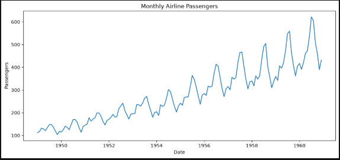
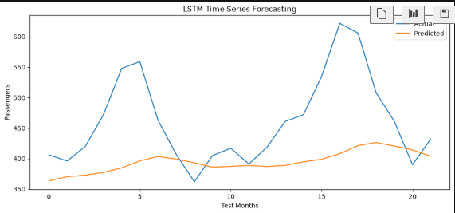

# train an LSTM model to predict airline passenger numbers for the next month using historical data.

We'll use the Airline Passengers dataset (monthly data from 1949–1960).

do:
1. What time-series forecasting is.
2. Sliding window technique.
3. How to prepare sequential data.
4. Train an LSTM model.
5. Evaluate predictions using MAE and RMSE.

Install libraries

    `uv add torch pandas numpy matplotlib scikit-learn`

Visualize the data:

Visualize predictions
